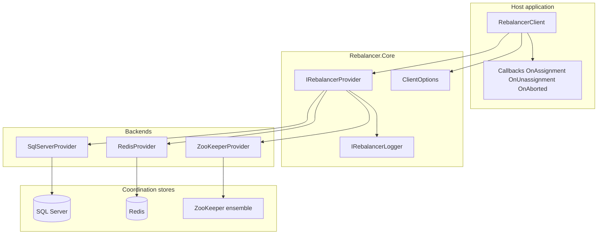

# Rebalancer — architecture overview

High-level view of the .NET solution. Libraries live under [`src/`](../../src/); samples under [`examples/`](../../examples/); automated tests under [`tests/`](../../tests/). For protocol detail, see [src/Rebalancer.ZooKeeper/README.md](../../src/Rebalancer.ZooKeeper/README.md) and [README.md](../../README.md).

**Registration:** pass the provider explicitly (`new RebalancerClient(new SqlServerProvider(connectionString))`) or use
the `Microsoft.Extensions.DependencyInjection` extensions in `src/Rebalancer.Extensions.DependencyInjection`
([ADR-0005](../adrs/0005-dependency-injection-for-provider-registration-v2.md)). The static `Providers` registry was
removed in 3.0 ([ADR-0013](../adrs/0013-explicit-providers-only-remove-static-registry.md)). A client owns and disposes
its provider; use one provider per client ([ADR-0016](../adrs/0016-rebalancer-client-owns-its-provider.md)).

Current version: **4.0.0** (all five packages). Release history: [`docs/release-notes/`](../release-notes/).

## Coordination state per backend

SQL Server and Redis share one coordinator / follower protocol: a lease with a fencing token elects the coordinator,
which writes each client's assignment into the store; followers read theirs on every heartbeat
([ADR-0002](../adrs/0002-coordinator-follower-lease-and-store-for-sqlserver-and-redis.md)). ZooKeeper uses leader
election and barriers ([ADR-0003](../adrs/0003-zookeeper-barriers-leader-election-and-rebalancing-modes.md)).

| Backend    | Group settings and lease                       | Resources                         | Client records                   |
|------------|------------------------------------------------|-----------------------------------|----------------------------------|
| SQL Server | `RBR.ResourceGroups` (row per group)           | `RBR.Resources`                   | `RBR.Clients`                    |
| Redis 4.0  | `RBR:Lease:{group}` (hash, one field)          | `RBR:Resources:{group}` (list)    | `RBR:Clients:{group}` (hash)     |
| ZooKeeper  | leader: lowest `{root}/{group}/clients/c_*`; `epoch` increments per rebalance | children of `{root}/{group}/resources`; its data holds the assignment table | ephemeral sequential `{root}/{group}/clients/c_*` |

- **Redis:** since 4.0 every key belongs to one group ([ADR-0020](../adrs/0020-per-group-redis-leases-and-resources.md));
  `{group}` is percent-encoded ([ADR-0015](../adrs/0015-store-redis-clients-per-resource-group.md)). The first 4.0 node
  of a group moves it out of the 3.x shared keys `Dictionary:RBR:ResourceGroups` and `List:RBR:Resources`
  ([migration guide](../release-notes/migrating-to-4.0.md)). Leases use the Redis server clock and compare-and-set
  updates ([ADR-0017](../adrs/0017-redis-lease-timing-and-atomic-updates.md)).
- **SQL Server:** schema in [`db/`](../../db/); the role `rebalancer_node` in `db/RebalanserLeastPrivilege.sql` grants
  exactly what a node needs.
- **ZooKeeper:** global-barrier mode also uses `{root}/{group}/status` and `{root}/{group}/stopped`.

## Safety mechanisms (SQL Server, Redis)

| Mechanism                                                                                   | Decision / record |
|---------------------------------------------------------------------------------------------|-------------------|
| Coordinator writes are guarded by its lease's fencing token; a newer coordinator wins         | ADR-0002          |
| A demoted coordinator records its status and clears its local state, so its successor's stop barrier includes it | PRB-0001          |
| Client records without a keep-alive for 10 × the lease expiry (configurable) are deleted      | ADR-0014          |
| A client that stopped responding but still holds resources is told to stop; it does so at its first tick after resuming | ADR-0019, PRB-0003 |
| No fencing token for resource handlers: a resumed process can run its handlers for up to one follower interval | ADR-0021 (option D) |

Keep the lease expiry (`LeaseExpirySeconds`) well above the longest pause a node can have (GC, VM freeze); see the
3.1.0 release notes.

## Access control

The library has no access control of its own; it relies on the store's identity. Threat models:
[TM-0001](../threat-models/TM-0001-zookeeper-coordination-and-acl.md) (ZooKeeper),
[TM-0002](../threat-models/TM-0002-sql-server-coordination.md) (SQL Server),
[TM-0003](../threat-models/TM-0003-redis-coordination.md) (Redis).

- **ZooKeeper:** credentials or an explicit ACL are required since 3.0 (ADR-0011); operator-created znodes are secured
  with the runbook in [`src/Rebalancer.ZooKeeper/README.md`](../../src/Rebalancer.ZooKeeper/README.md).
- **SQL Server:** a dedicated login in the role `rebalancer_node`.
- **Redis:** one ACL user per group, confined to `RBR:Lease:{g}`, `RBR:Resources:{g}` and `RBR:Clients:{g}` (4.0).
