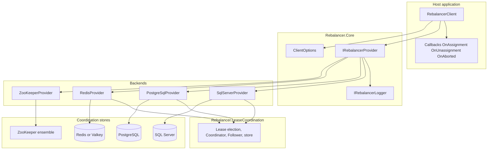

# Rebalancer — architecture overview

High-level view of the .NET solution. Libraries live under [`src/`](../../src/); samples under [
`examples/`](../../examples/); automated tests under [`tests/`](../../tests/). For protocol detail,
see [src/Rebalancer.ZooKeeper/README.md](../../src/Rebalancer.ZooKeeper/README.md) and [README.md](../../README.md).

**Registration:** pass the provider explicitly (`new RebalancerClient(new SqlServerProvider(connectionString))`) or use
the `Microsoft.Extensions.DependencyInjection` extensions in `src/Rebalancer.Extensions.DependencyInjection`
([ADR-0005](../adrs/0005-dependency-injection-for-provider-registration-v2.md)). The static `Providers` registry was
removed in 3.0 ([ADR-0013](../adrs/0013-explicit-providers-only-remove-static-registry.md)). A client owns and disposes
its provider; use one provider per client ([ADR-0016](../adrs/0016-rebalancer-client-owns-its-provider.md)).

Current version: **5.0.0**: SQL Server, PostgreSQL and Redis share their coordination code in
`Rebalancer.LeaseCoordination`; SQL Server and Redis service types moved namespace (eight library packages; CR-0013,
[migration guide](../release-notes/migrating-to-5.0.md)).
Release history: [`docs/release-notes/`](../release-notes/).

## Coordination state per backend

SQL Server, PostgreSQL and Redis share one coordinator / follower protocol: a lease with a fencing token elects the
coordinator, which writes each client's assignment into the store; followers read theirs on every heartbeat. One copy of
it lives in `src/Rebalancer.LeaseCoordination`; each backend adds only its lease, client and resource services
([ADR-0029](../adrs/0029-shared-coordination-project-for-sqlserver-and-redis.md), superseding
[ADR-0002](../adrs/0002-coordinator-follower-lease-and-store-for-sqlserver-and-redis.md)). ZooKeeper uses leader
election and barriers ([ADR-0003](../adrs/0003-zookeeper-barriers-leader-election-and-rebalancing-modes.md)). PostgreSQL
([ADR-0030](../adrs/0030-postgresql-backend.md)) was added in 5.0 on the shared code.

| Backend    | Group settings and lease                                                                               | Resources                                                                   | Client records                                    |
|------------|--------------------------------------------------------------------------------------------------------|-----------------------------------------------------------------------------|---------------------------------------------------|
| SQL Server | `RBR.ResourceGroups` (row per group)                                                                   | `RBR.Resources`                                                             | `RBR.Clients`                                     |
| PostgreSQL | `rbr.resource_groups` (row per group)                                                                  | `rbr.resources`                                                             | `rbr.clients`                                     |
| Redis 4.0  | `RBR:Lease:{group}` (hash, one field)                                                                  | `RBR:Resources:{group}` (list)                                              | `RBR:Clients:{group}` (hash)                      |
| ZooKeeper  | leader: lowest `{root}/{group}/clients/c_*`; `epoch` (znode version) increments per coordinator tenure | children of `{root}/{group}/resources`; its data holds the assignment table | ephemeral sequential `{root}/{group}/clients/c_*` |

- **Redis:** since 4.0 every key belongs to one group
  ([ADR-0020](../adrs/0020-per-group-redis-leases-and-resources.md));
  `{group}` is percent-encoded ([ADR-0015](../adrs/0015-store-redis-clients-per-resource-group.md)). The first 4.0 node
  of a group moves it out of the 3.x shared keys `Dictionary:RBR:ResourceGroups` and `List:RBR:Resources`
  ([migration guide](../release-notes/migrating-to-4.0.md)). Leases use the Redis server clock and compare-and-set
  updates ([ADR-0017](../adrs/0017-redis-lease-timing-and-atomic-updates.md)).
- **SQL Server:** schema in [`db/sqlserver/`](../../db/sqlserver/); the role `rebalancer_node` in
  `db/sqlserver/RebalancerLeastPrivilege.sql` grants exactly what a node needs.
- **PostgreSQL:** schema and role in [`db/postgresql/`](../../db/postgresql/). A lease operation locks the group row
  (`SELECT … FOR UPDATE`) and reads the time with `clock_timestamp()` after the lock; it ends a stalled transaction
  after half the lease expiry ([TM-0004](../threat-models/TM-0004-postgresql-coordination.md), D2).
- **Valkey:** the Redis backend, unchanged; every Redis integration test also runs on Valkey 8.1.11
  ([ADR-0031](../adrs/0031-valkey-as-a-supported-server-for-the-redis-backend.md)).
- **ZooKeeper:** global-barrier mode also uses `{root}/{group}/status` and `{root}/{group}/stopped`.

## Safety mechanisms (SQL Server, PostgreSQL, Redis)

| Mechanism                                                                                                                                                                                                   | Decision / record   |
|-------------------------------------------------------------------------------------------------------------------------------------------------------------------------------------------------------------|---------------------|
| Coordinator writes are guarded by its lease's fencing token; a newer coordinator wins                                                                                                                       | ADR-0002            |
| A demoted coordinator records its status and clears its local state, so its successor's stop barrier includes it                                                                                            | PRB-0001            |
| Client records without a keep-alive for 10 × the lease expiry (configurable) are deleted                                                                                                                    | ADR-0014            |
| A client that stopped responding but still holds resources is told to stop; it does so at its first tick after resuming                                                                                     | ADR-0019, PRB-0003  |
| A coordinator acts only while the lease names it with its fencing token: each tick checks it, stop and grant carry it, a fenced-out coordinator stops its handlers, and each tenure starts with a rebalance | ADR-0026            |
| A client that restarts after an error resets its record as a new registration would, so it is assigned again                                                                                                | PRB-0005            |
| No fencing token for resource handlers: a resumed process can run its handlers for up to one follower interval                                                                                              | ADR-0021 (option D) |

Keep the lease expiry (`LeaseExpirySeconds`) well above the longest pause a node can have (GC, VM freeze); see the
3.1.0 release notes. The lease guard and the record reset are in the built-in client services only; a custom
`IClientService` keeps the earlier behavior.

## Safety mechanisms (ZooKeeper)

| Mechanism                                                                                                                         | Decision / record |
|-----------------------------------------------------------------------------------------------------------------------------------|-------------------|
| The lowest client znode leads; its table writes carry the expected `resources` version, and the epoch watch demotes a stale one   | ADR-0003          |
| Resource-barrier mode: a client deletes only the barriers that hold its client id, and forgets its resources after a lost session | ADR-0027          |
| A client stops its handlers at `Disconnected`, before ZooKeeper can expire its session, and restarts them if the session survives | ADR-0028          |

Keep stop handlers shorter than about a third of the session timeout. A process paused longer than the session timeout
cannot act at all; that risk stays as ADR-0021 accepts it.

The coordination protocols are specified in TLA+ in [`docs/tlaplus/`](../tlaplus/README.md).

## Errors

`OnAborted` reports an error. ZooKeeper raises it only when a client gives up; SQL Server, PostgreSQL and Redis raise it
for every error, and with auto-recovery the client restarts and is assigned again (a follower too since the PRB-0005
fix;
until then its record stayed `Terminated`). A client that gives up reports `ClientState.Aborted` on all four backends;
SQL Server and Redis have reported this state since 4.2.0 (US-0021). Hosts should judge participation by
`GetCurrentState()`, not by the event.

## Observability

- **Metrics and traces** ([ADR-0022](../adrs/0022-rebalancing-telemetry-contract.md)): meter and activity source
  `Rebalancer` in `Rebalancer.Core` (`RebalancerTelemetry`). `RebalancerClient` records assignments, unassignments and
  the unassigned duration; the backends' coordinators record rebalances (with an activity per rebalance) and
  elections. Tags: backend and group; never resource names.
- **Health** ([ADR-0023](../adrs/0023-health-check-for-a-rebalancer-client.md)): `RebalancerClientHealthCheck` in its
  own package observes the host's client (state, and `OnAborted` until the client is assigned again); it never calls
  the backend. All four backends report `ClientState.Aborted` after a final error; SQL Server and Redis have done so
  since 4.2.0 (US-0021).

## Access control

The library has no access control of its own; it relies on the store's identity. Threat models:
[TM-0001](../threat-models/TM-0001-zookeeper-coordination-and-acl.md) (ZooKeeper),
[TM-0002](../threat-models/TM-0002-sql-server-coordination.md) (SQL Server),
[TM-0003](../threat-models/TM-0003-redis-coordination.md) (Redis),
[TM-0004](../threat-models/TM-0004-postgresql-coordination.md) (PostgreSQL).

- **ZooKeeper:** credentials or an explicit ACL are required since 3.0 (ADR-0011); operator-created znodes are secured
  with the runbook in [`src/Rebalancer.ZooKeeper/README.md`](../../src/Rebalancer.ZooKeeper/README.md).
- **SQL Server:** a dedicated login in the role `rebalancer_node`.
- **Redis:** one ACL user per group, confined to `RBR:Lease:{g}`, `RBR:Resources:{g}` and `RBR:Clients:{g}` (4.0).
